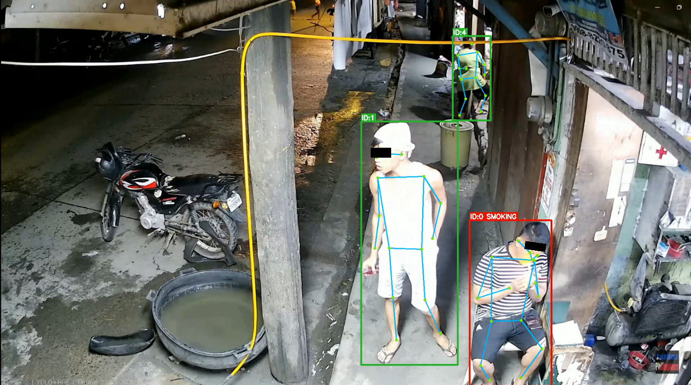
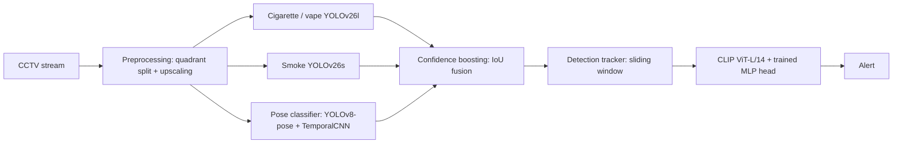

# A Hierarchical Multimodal Pipeline for Smoking Detection in CCTV Video with Cross-Domain Generalization

**Code and experimental notebooks accompanying the anonymized manuscript**

> A hierarchical multimodal pipeline for smoking detection in CCTV video with cross-domain generalization

The pipeline detects smoking (cigarettes, vapes, and other nicotine-delivery devices) in surveillance video. It combines two specialized YOLO detectors, IoU-based confidence boosting, a sliding-window detection tracker, pose-based gesture classification, and CLIP-based verification with a lightweight MLP head.

**Evaluation protocol:** All learned components are trained on non-CCTV development data. The scalar fusion parameters are calibrated on the **training data of the corresponding components**, not on the real CCTV recordings. **All 203 real CCTV clips are used exclusively for out-of-domain (OOD) testing.** There is no calibration/test subdivision of this CCTV corpus.

<p align="center">
  
</p>
<p align="center"><em>Representative result on real CCTV footage: one tracked person is flagged as smoking; two bystanders are not. The visible eyes are masked for privacy.</em></p>

## Key results

- **Precision 0.947, recall 0.956, F1 0.951** (95% CI ±0.008) on the **203-clip CCTV OOD test corpus**.
- **+14.5 F1 percentage points** over a single-detector YOLO baseline (F1: 0.8057 → 0.9510; approximately +18.0% relative).
- A trained MLP head on frozen CLIP ViT-L/14 embeddings improves F1 by **14.3 points** compared with the best zero-shot CLIP configuration (0.951 vs. 0.808).
- The strongest cigarette/vape detector is **YOLOv26l** trained on the *small* split and evaluated on the *micro* split (mAP@0.5 = 0.830).
- The full pipeline runs at **18.3 FPS** on an NVIDIA A100 (40 GB).

These values are reported in the accompanying manuscript; the private CCTV recordings cannot be redistributed.

## Pipeline



1. **Preprocessing.** Each frame is divided into four non-overlapping quadrants. Each quadrant is upscaled to the detector input resolution, and predicted boxes are mapped back to the original frame. This helps with very small objects typical of wide-angle CCTV footage.
2. **Independent object detectors.** YOLOv26l detects cigarettes/vapes, and YOLOv26s detects smoke. Smoke alone does **not** trigger a smoking alert.
3. **Confidence boosting.** Let `c` be the cigarette/vape detection confidence, `IoU_p` its overlap with the nearest person box, and `IoU_s` its overlap with the nearest smoke box. The number of confirming signals is:

   $$
   n = \mathbb{1}[\mathrm{IoU}_p \ge 0.3] + \mathbb{1}[\mathrm{IoU}_s \ge 0.1].
   $$

   The adjusted confidence is:

   $$
   c_1 = \begin{cases}
   0.85c, & n=0, \\
   \min\!\big(c(1+0.25\mathrm{IoU}_p+0.10\mathrm{IoU}_s),\;0.85\big), & n\ge 1.
   \end{cases}
   $$

   If the pose score `s_hpe` exceeds `θ_hpe = 0.5`, a second adjustment is applied:

   $$
   c_{\mathrm{final}}=\min\!\big(c_1(1+0.2s_{\mathrm{hpe}}),\;1.0\big).
   $$

   Otherwise `c_final = c_1`; absence of a smoking-like pose does not veto the detection.
4. **Detection tracker.** An IoU-based tracker associates detections across frames. An alert is raised when more than **T = 3** of the last **N = 8** frames contain a positive detection for the tracked object:

   $$
   \mathrm{alert}_t = \mathbb{1}\left[\sum_{i=t-N+1}^{t} y_i > T\right].
   $$

5. **CLIP verification.** Each detected object's bounding box is expanded by a factor of 6×. A frozen CLIP ViT-L/14 image encoder supplies a 768-dimensional embedding to a trained MLP head: `Linear(768→256) → ReLU → Dropout(0.3) → Linear(256→1) → Sigmoid`. Verification is performed periodically per tracked object rather than on every frame.

## Data and evaluation protocol

### Development data

- **Cigarettes/vapes:** approximately 70,000 labelled images assembled from 16 public Roboflow Universe and Kaggle sources, with the source train/validation/test splits retained. The *micro* split selects bounding boxes occupying at most **0.2%** of image area (8,544 train / 1,240 val / 920 test); the *small* split uses a **1.0%** threshold (27,286 / 3,933 / 2,738).
- **Smoke:** four public sources—D-Fire, a Roboflow fire/smoke dataset, the METU fire/smoke dataset, and Smoke100K. Fire-only labels are omitted. The *micro* and *small* thresholds are **0.5%** and **4%** of image area, respectively.
- **Human pose:** HMDB51, MEVA, and in-house annotations, comprising **555 training videos** (88 smoking; 467 non-smoking) and **137 validation videos** (21 smoking; 116 non-smoking). The pose extractor uses **17 keypoints per frame** from YOLOv8-pose, which are converted to 15-dimensional hand/face geometric features for the classifiers.
- **CLIP MLP head:** 5,000 class-balanced image crops derived from the training portion of the cigarette/vape dataset (3,000 train / 1,000 validation / 1,000 test). Inference crops expand the detection box by **6×**.

### Parameter calibration — without real CCTV footage

The manuscript describes the following calibration sources:

| Component / parameter | Development data used to calibrate it |
| --- | --- |
| IoU-based confidence-boost coefficients | Combined training data feeding the fusion: cigarette/vape detector micro and small training subsets, smoke detector training data, and 555 pose-training videos |
| Pose-confirmation threshold, `θ_hpe` | 555 pose-training videos |
| Tracker window and threshold (`N = 8`, `T = 3`) | The same development training data |
| CLIP zero-shot similarity threshold | The 5,000-crop CLIP-head corpus |

The learned detectors, pose classifiers, and CLIP head are **not** trained or fine-tuned on the real CCTV corpus. The scalar parameters are **not** tuned on that corpus either. Hyperparameter/model selection on development data is distinct from the separate real-CCTV evaluation.

### Out-of-domain (OOD) CCTV test set

A third party supplied **203 real surveillance clips**, comprising **163 clips with smoking** (mean duration 19 seconds) and **40 clips without smoking** (mean duration 26 seconds). The ground-truth annotations are smoking time intervals/person identifiers rather than bounding boxes; system-level results are therefore reported as clip-level classification metrics. **All 203 clips form the OOD test set.** These recordings are held out of all training and calibration and are **not publicly redistributable** under the data-use agreement.

## Experimental results

All **OOD** columns below refer to the **entire 203-clip CCTV test set**. The **test** columns for individual models refer to held-out splits of the non-CCTV development datasets. The numbers reproduce the manuscript tables.

### Contribution of pipeline components

| Component | Precision | Recall | F1 | 95% CI (F1) |
| --- | ---: | ---: | ---: | ---: |
| YOLO cigarette/vape (baseline) | 0.7900 | 0.8220 | 0.8057 | ±0.012 |
| + smoke detection (confidence boost) | 0.8450 | 0.8109 | 0.8276 | ±0.011 |
| + DetectionTracker | 0.8681 | 0.8394 | 0.8535 | ±0.013 |
| + HPE (TemporalCNN) | 0.8912 | 0.8531 | 0.8717 | ±0.018 |
| + CLIP ViT-L/14, detailed prompt (zero-shot) | 0.8103 | 0.8052 | 0.8077 | ±0.014 |
| **CLIP ViT-L/14 + MLP (final)** | **0.9470** | **0.9560** | **0.9510** | **±0.008** |

Zero-shot CLIP applied as a hard verification gate reduces F1 relative to the preceding pose-aware configuration; the trained MLP head substantially improves performance.

### Cigarette/vape detector comparison

| Model (train split) | Eval split | mAP@0.5 (test) | P (test) | R (test) | F1 (test) | P (OOD) | R (OOD) | F1 (OOD) |
| --- | --- | ---: | ---: | ---: | ---: | ---: | ---: | ---: |
| **YOLOv26l (small)** | micro | **0.830** | **0.845** | **0.811** | **0.828** | **0.828** | **0.794** | **0.811** |
| YOLOv26m (small) | small | 0.685 | 0.789 | 0.749 | 0.769 | 0.773 | 0.732 | 0.752 |
| YOLOv26l (micro) | micro | 0.676 | 0.810 | 0.714 | 0.759 | 0.792 | 0.698 | 0.742 |
| YOLOv26m (micro) | small | 0.763 | 0.816 | 0.801 | 0.808 | 0.799 | 0.784 | 0.792 |
| Faster R-CNN | micro | 0.731 | 0.731 | 0.695 | 0.712 | 0.715 | 0.680 | 0.697 |
| Enos123 YOLOv11m (open-source) | micro | 0.391 | 0.651 | 0.455 | 0.536 | 0.637 | 0.446 | 0.525 |
| AarnoStormborn YOLOv5 (open-source) | micro | 0.309 | 0.660 | 0.386 | 0.487 | 0.646 | 0.378 | 0.477 |

### Smoke detector comparison

| Model | Type | Eval split | mAP@0.5 (test) | P (test) | R (test) | F1 (test) | P (OOD) | R (OOD) | F1 (OOD) |
| --- | --- | --- | ---: | ---: | ---: | ---: | ---: | ---: | ---: |
| **YOLOv26s** | in-house | micro | **0.733** | **0.740** | **0.724** | **0.732** | **0.721** | **0.706** | **0.714** |
| YOLOv26m | in-house | micro | 0.599 | 0.592 | 0.630 | 0.610 | 0.577 | 0.615 | 0.595 |
| YOLOv26s | in-house | small | 0.718 | 0.729 | 0.645 | 0.684 | 0.712 | 0.630 | 0.669 |
| YOLOv26m | in-house | small | 0.729 | 0.738 | 0.644 | 0.688 | 0.721 | 0.630 | 0.672 |
| TommyNgx YOLOv10 | open-source | micro | **0.554** | 0.762 | 0.632 | 0.691 | 0.744 | 0.617 | 0.674 |
| leeyunjai YOLOv11s | open-source | micro | 0.119 | 0.623 | 0.157 | 0.251 | 0.608 | 0.154 | 0.245 |
| leeyunjai YOLOv11x | open-source | micro | 0.116 | 0.553 | 0.162 | 0.250 | 0.540 | 0.158 | 0.244 |

### Human-pose-based smoking gesture classification

| Model | F1 (test) | ROC-AUC (test) | PR-AUC (test) | F1 (OOD) | ROC-AUC (OOD) | PR-AUC (OOD) |
| --- | ---: | ---: | ---: | ---: | ---: | ---: |
| RandomForest | 0.567 | 0.974 | 0.662 | 0.548 | 0.961 | 0.649 |
| GradientBoosting + SMOTE | 0.611 | 0.981 | 0.561 | 0.591 | 0.967 | 0.548 |
| SVM-RBF | 0.521 | 0.723 | 0.614 | 0.502 | 0.709 | 0.602 |
| MLP (1 hidden layer) | 0.602 | 0.978 | 0.683 | 0.581 | 0.964 | 0.669 |
| GBM + SMOTE (periodicity features) | 0.636 | 0.970 | 0.722 | 0.615 | 0.956 | 0.708 |
| ST-GCN | 0.727 | 0.970 | 0.729 | 0.709 | 0.956 | 0.715 |
| **TemporalCNN** | **0.800** | **0.997** | **0.838** | **0.781** | **0.975** | **0.820** |

### CLIP zero-shot verification

| Configuration | Threshold | P (OOD) | R (OOD) | F1 (OOD) |
| --- | ---: | ---: | ---: | ---: |
| CLIP RN50 / basic prompt | 0.40 | 0.827 | 0.661 | 0.735 |
| CLIP RN50 / detailed prompt | 0.35 | 0.828 | 0.722 | 0.771 |
| CLIP ViT-L/14 / basic prompt | 0.30 | 0.838 | 0.543 | 0.659 |
| **CLIP ViT-L/14 / detailed prompt** | **0.35** | **0.810** | **0.805** | **0.808** |
| Tuned YOLO (no VLM) | — | 0.759 | 0.852 | 0.803 |
| Baseline YOLO (no VLM) | — | 0.790 | 0.822 | 0.806 |

### CLIP embedding distillation

| Configuration | P (OOD) | R (OOD) | F1 (OOD) |
| --- | ---: | ---: | ---: |
| LogReg baseline (CLIP RN50) | 0.878 | 0.918 | 0.897 |
| MLP (CLIP RN50) | 0.910 | 0.926 | 0.918 |
| LogReg (CLIP ViT-L/14) | 0.945 | 0.922 | 0.933 |
| **MLP (CLIP ViT-L/14)** | **0.947** | **0.956** | **0.951** |

### Comparison with published systems

| System | Precision | Recall | F1 | OOD evaluation |
| --- | ---: | ---: | ---: | --- |
| Wang et al., YOLOv8-MNC | 0.920 | 0.790 | 0.850 | No |
| Lakatos et al., multimodal (text) | 0.980 | — | — | No (text modality) |
| **This work** | **0.947** | **0.956** | **0.951** | **Yes** |

### Runtime performance

Measured over five runs of 500 frames, for the complete system.

| Hardware | FPS | 2× YOLO (ms/frame) | HPE (ms/frame) | CLIP (ms/call) | Tracker (ms/frame) |
| --- | ---: | ---: | ---: | ---: | ---: |
| NVIDIA A100 40 GB | 18.3 | 24.1 | 8.3 | 51.2 | 2.1 |
| NVIDIA V100 32 GB | 9.7 | 42.8 | 15.1 | 98.6 | 2.4 |
| Intel Core i7-12650H (CPU) | 4.8 | 87.3 | 31.5 | 189.4 | 3.2 |

## Repository structure

```text
.
├── notebooks/
│   ├── 01_data_preparation.ipynb              # Dataset assembly and micro/small splits
│   ├── 02_cigarette_detector_training.ipynb   # Detector training and evaluation
│   ├── 03_cigarette_detector_comparison.ipynb # Comparison with community models
│   ├── 04_smoke_detector_comparison.ipynb     # Smoke-detector comparisons
│   ├── 05_pose_estimation.ipynb               # Pose features, gesture classification, fusion
│   └── 06_clip_verification.ipynb             # CLIP zero-shot and MLP verification
├── service/                                  # FastAPI monitoring service
│   ├── main.py
│   ├── auth.py
│   ├── routers/
│   ├── templates/
│   ├── static/
│   └── requirements.txt
├── assets/
│   └── qualitative_example.png
├── requirements.txt
└── README.md
```

| Notebook | Main manuscript sections / tables |
| --- | --- |
| `01_data_preparation.ipynb` | §3.2, data assembly and filtering |
| `02_cigarette_detector_training.ipynb` | §§3.3, 4.2; Table 2 |
| `03_cigarette_detector_comparison.ipynb` | §4.2; Table 2 |
| `04_smoke_detector_comparison.ipynb` | §4.3; Table 3 |
| `05_pose_estimation.ipynb` | §§3.3, 4.4; Table 4 and Appendix A |
| `06_clip_verification.ipynb` | §§3.3, 4.5–4.6; Tables 5–6 |

## Installation and usage

**Requirements:** Python 3.10 is the reported experimental environment; NVIDIA GPUs are recommended for training and full-speed inference. Dependencies are listed in `requirements.txt` (experiments) and `service/requirements.txt` (web service).

```bash
git clone https://github.com/AnonymizedGity/smoking_detection_cctv.git
cd smoking_detection_cctv
python -m venv .venv
source .venv/bin/activate    # Windows PowerShell: .venv\Scripts\Activate.ps1
pip install -r requirements.txt
```

The experiments reported in the manuscript used PyTorch 2.6, Ultralytics 8.4.12, and an NVIDIA A100 40 GB for detector training. Detector settings: AdamW, learning rate `1e-4`, weight decay `0.01`, cosine annealing with `T_max=100`, 100 epochs, batch size 16, fixed seed 42, and five training runs per configuration for uncertainty estimates.

The notebooks are organized as experiments, not as a single self-contained reproduction script. To run them, obtain the public datasets and configure the dataset/checkpoint paths as indicated in their cells. The YOLO-style layouts used by the original notebooks include `yolo_dataset/{train,val,test}/{images,labels}` and `smoke_yolo_dataset_micro/`. Some comparisons download Roboflow weights and need an API key, provided via the environment rather than committed in source code:

```bash
export ROBOFLOW_API_KEY="YOUR_KEY"
```

To install the service-specific dependencies:

```bash
pip install -r service/requirements.txt
```

The service uses FastAPI/Uvicorn and supports RTSP streams, live viewing, and alerts. Deployment-specific camera URLs, model checkpoints, and secrets should be supplied by the operator; do not commit actual credentials or private CCTV footage.

**Reproducibility limitation:** The real CCTV test videos are not included because of the data-use agreement. As a result, independent users can run the public-data experiments with the necessary resources but cannot reproduce the reported OOD metrics without access to the restricted footage.

## Data and code availability

The source code and experimental notebooks are intended to be distributed via this anonymized repository for peer review. The real CCTV videos are restricted third-party data and are not included. Other data availability is described in the manuscript.
